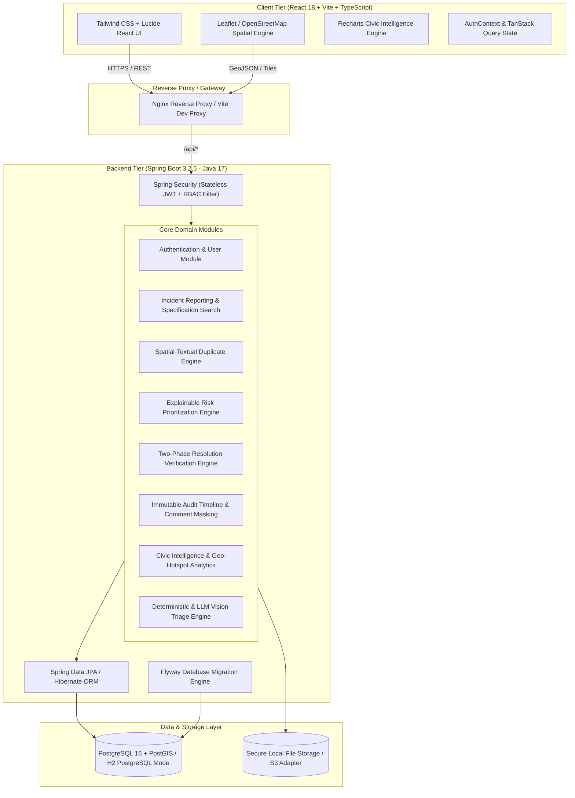
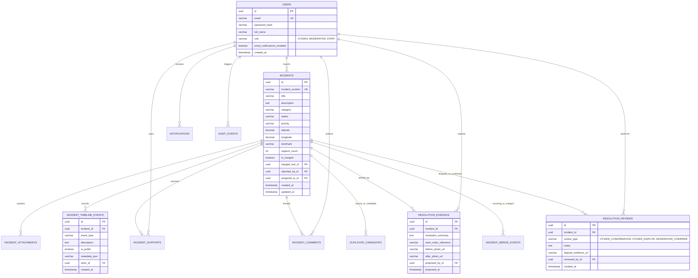

# CivicTrack 2.0 — AI-Powered Civic Accountability and Issue Resolution Platform

[](https://spring.io/projects/spring-boot)
[](https://reactjs.org/)
[](https://vitejs.dev/)
[](https://tailwindcss.com/)
[](https://leafletjs.com/)
[](LICENSE)

> **Tagline:** Report it. Track it. Verify it.  
> **Core Differentiator:** Civic accountability through photographic evidence, duplicate-aware reporting, explainable risk prioritization, transparent audit timelines, and citizen-verified resolution challenges.

---

## 📌 Executive Overview

In urban environments worldwide, citizen infrastructure complaints (potholes, burst pipes, broken streetlights, overflowing waste, flooded roadways) suffer from a fundamental accountability breakdown:
1. **Duplicate Avalanche:** Tens of residents independently submit complaints for the same road hazard, fragmenting municipal attention and distorting operational priorities.
2. **"Black Box" Triage:** Citizens never understand why a minor cosmetic issue gets fixed while an active pedestrian safety hazard sits unaddressed for months.
3. **Premature / Bogus Resolution:** Work orders are marked "Resolved" in closed government databases without photographic proof, leaving citizens disempowered when the pothole is still there.

**CivicTrack 2.0** solves this with an end-to-end, transparent civic accountability lifecycle. It couples **spatial-textual duplicate detection**, an **explainable multi-factor risk engine**, and a strict **two-phase resolution verification protocol** where citizens inspect before/after evidence and hold public authorities accountable.

---

## 🏗️ Architecture & System Design

CivicTrack 2.0 is designed as a **clean, modular monolith** ensuring high maintainability, rapid onboarding, transactional integrity, and straightforward local testing while retaining a production-ready path to microservices or serverless deployments.

### High-Level Architecture Diagram



---

## 🗄️ Database Architecture & Entity Relationship

The database schema is strictly normalized and versioned through **Flyway migrations** (`V1__initial_schema.sql`). It enforces foreign key constraints, composite unique indexes (e.g., one upvote/support per user per incident), and spatial bounding-box indexing.

### Entity-Relationship Diagram



---

## ⚡ Core Engineering Differentiators

### 1. Spatial-Textual Duplicate Detection Engine
When a citizen reports an issue or reviews nearby reports:
- **Haversine Distance Filter:** Computes great-circle spatial separation ($r = 6371\text{ km}$), immediately pruning incidents outside a configurable threshold (default: **500 meters**).
- **Jaccard Token Text Similarity:** Performs tokenization, lowercasing, and intersection-over-union metric on civic terminology.
- **Combined Candidate Score:**
  $$\text{DuplicateScore} = 0.55 \times \text{SpatialFactor} + 0.35 \times \text{TextSimilarity} + 0.10 \times \text{CategoryCompatibility}$$
- **One-Click Citizen Support:** Instead of creating redundant tickets, citizens can immediately click **"Support Existing Incident"**, increasing visibility without inflating backlogs.
- **Moderator Merge Protocol:** Preserves the canonical incident while archiving duplicate records, transferring community support counts, recording bidirectional timeline events, and maintaining a complete merge audit trail.

### 2. Transparent Multi-Factor Risk Prioritization Engine
Rather than relying on opaque AI predictions, CivicTrack 2.0 computes priority using a transparent, explainable scoring breakdown:
- **Category Baseline:** Hazardous categories (e.g., *Roads & Potholes*, *Drainage & Waterlogging*) receive a safety weighting.
- **Hazard Keyword Detection:** Scans text for critical keywords (`accident`, `hazard`, `danger`, `exposed`, `injury`, `deep`, `burst`, `school`, `hospital`).
- **Community Density Factor:** Logarithmic scaling based on unique citizen upvotes/supports.
- **Stagnation Factor:** Automatically escalates score if an incident remains unaddressed past SLA thresholds (e.g., > 14 days).
- **Result:** Classifies into `LOW`, `MEDIUM`, `HIGH`, or `CRITICAL` accompanied by human-readable explanations (e.g., *"Road hazard with safety keywords + 12 citizen supports"*).

### 3. Two-Phase Resolution Verification & Dispute Protocol
A major failure of municipal complaint portals is the unilateral "Resolved" stamp. CivicTrack enforces:
1. **Resolution Proposed (`RESOLUTION_PROPOSED`):** Authorized staff must submit mandatory before/after photographic proof, work-order references, and an official completion summary.
2. **Citizen Inspection Window (`RESOLVED_AWAITING_VERIFICATION`):** The reporting citizen and community supporters are notified. Citizens have full power to:
   - **Confirm Resolution:** Transition incident to `CLOSED`.
   - **Challenge Resolution (Dispute):** Upload fresh photographic proof that the issue was improperly fixed, automatically transitioning incident to `REOPENED` and creating a high-priority review task.

### 4. Zero-Cost Fallback AI Classifier with Strict Safety Constraints
- Employs a **Deterministic NLP Provider** that inspects image filenames and descriptions to extract categories, confidence scores, and safety flags.
- Configurable for **OpenAI / Claude / Spring AI Vision** integration.
- **Safety Boundary:** AI suggestions are explicitly marked with `isSimulated=true` when using the deterministic provider. AI outputs *never* trigger automated state changes or emergency dispatches without human authorization.

---

## 👥 User Roles & Seeded Demo Personas

CivicTrack 2.0 includes a development database seeder with realistic civic incidents and pre-configured accounts.

| Role | Email | Password | Primary Capabilities |
| :--- | :--- | :--- | :--- |
| **Citizen** | `citizen@civictrack.org` | `Password123!` | Report issues, pin GPS locations, upload photos, support nearby issues, challenge faulty resolutions, view personal dashboard. |
| **Moderator** | `moderator@civictrack.org` | `Password123!` | Review public queue, inspect duplicate candidate scores, merge redundant tickets with audit history, triage AI suggestions. |
| **Operations Staff** | `staff@civictrack.org` | `Password123!` | Assign field teams, transition work stages (`IN_PROGRESS`), submit before/after resolution evidence, respond to disputes. |

> 💡 **Recruiter Tip:** The navigation header features an **instant 1-click Role Switcher** dropdown allowing you to switch between Citizen, Moderator, and Operations Staff in 1 second without typing login credentials.

---

## 🚀 Step-by-Step Recruiter Demonstration Script

Follow this 5-minute walkthrough to evaluate all critical platform workflows:

### Step 1: Browse Public Accountability Map & Explore Issues
1. Open the application at `http://localhost:5173/`.
2. Navigate to **Explore Issues** or **Interactive Map**.
3. Toggle category and priority filters (e.g., *Roads & Potholes*, *High Priority*).
4. Click on the Leaflet map pins to view incident cards, citizen support counts, and current progress status badges.

### Step 2: Citizen Reporting with Real-Time Duplicate Warning
1. Click **Report an Issue** in the navbar.
2. Enter Title: `"Deep hazardous pothole near metro station"`
3. Select Category: `Roads & Potholes`
4. Notice how the **AI Assistance Engine** automatically predicts category tags and hazard notes in real-time.
5. In the description, type: `"Car tire blew out due to deep depression in the left lane."`
6. Click **Find Duplicate Incidents**: The spatial-textual engine checks the database and flags potential duplicates within 500m with match scores.
7. Click the interactive map to position your GPS pin or use current geolocation.
8. Submit the report: an official incident ticket (e.g., `CT-2024-XXXX`) is issued and appended to your **My Reports** dashboard.

### Step 3: Moderator Review & Duplicate Incident Merge
1. Switch to the **Moderator** persona using the navbar switcher.
2. Go to **Duplicate Review** (`/admin/duplicates`).
3. Inspect the side-by-side comparison of two nearby waterlogging reports with a **88% duplicate confidence score**.
4. Click **Merge Incidents**: The secondary ticket is merged into the primary surviving incident. Support counts are combined, a bidirectional audit event is recorded, and the merged incident now redirects to the canonical ticket.

### Step 4: Operations Staff Work Lifecycle & Before/After Evidence
1. Switch to the **Operations Staff** persona.
2. Navigate to **Operations Dashboard** (`/admin/operations`).
3. Click on an assigned incident in `CONFIRMED` status.
4. Click **Update Status** &rarr; select `IN_PROGRESS` with an internal work note.
5. Once complete, click **Propose Resolution**:
   - Work Order: `WO-2024-8841`
   - Summary: `"Asphalt repaved and compacted with heavy roller. Drainage cleared."`
   - Attach Before & After URLs / photos.
6. Submit resolution: The incident moves to `RESOLVED_AWAITING_VERIFICATION`.

### Step 5: Citizen Dispute Challenge
1. Switch back to **Citizen** persona.
2. Navigate to **Resolution Verification Queue** or open the incident details page.
3. Observe the side-by-side **Before vs After Photographic Evidence Card**.
4. Click **Challenge Resolution (Dispute)**:
   - Provide explanation: *"The repair washed away in yesterday's rain. The pothole is still 4 inches deep."*
5. Submit dispute: The incident is immediately escalated to `REOPENED`, an audit warning is generated, and operations staff are flagged for re-inspection.

### Step 6: Civic Intelligence & Geo-Hotspot Analytics
1. Switch to **Operations Staff** or **Moderator** and click **Analytics** (`/admin/analytics`).
2. Review real-time database-computed metrics:
   - Status distribution breakdown.
   - Resolution verification and challenge rates.
   - Category frequency chart.
   - **Recurring Problem Hotspots (1.1km Grid Clustering):** Identifies clusters of 3+ complaints within the same neighborhood to detect systemic infrastructure neglect.

---

## 🛠️ Technology Stack Breakdown

### Frontend
- **Framework:** React 18.3 with TypeScript 5
- **Tooling:** Vite 5.4, ESBuild
- **Styling:** Tailwind CSS 3.4 with custom civic navy/emerald design system
- **Mapping:** Leaflet 1.9 & React-Leaflet with OpenStreetMap cartography
- **Data Visualization:** Recharts for analytics histograms and category donuts
- **Icons:** Lucide React
- **HTTP Client:** Axios with JWT interceptors
- **Testing:** Vitest & React Testing Library

### Backend
- **Framework:** Spring Boot 3.2.5 (Java 17 LTS)
- **Security:** Spring Security with stateless HMAC-SHA256 JWT tokens & RBAC method security
- **Data Access:** Spring Data JPA, Hibernate ORM
- **Spatial Calculations:** Haversine Great-Circle formula with latitude/longitude bounding-box optimizations
- **Migrations:** Flyway 9.22.3 version-controlled SQL scripts
- **API Documentation:** SpringDoc OpenAPI 3 / Swagger UI
- **Testing:** JUnit 5, Mockito, Spring Boot Test

### Databases & Infrastructure
- **Production Mode:** PostgreSQL 16 + PostGIS
- **Zero-Setup Local Dev Mode:** File-backed H2 running in PostgreSQL compatibility mode (`./backend/data/civictrack.mv.db`)
- **Containers:** Docker Compose with multi-stage Dockerfiles for backend and frontend

---

## 💻 Local Setup & Installation

### Prerequisites
- **Java:** JDK 17 or higher (`java -version`)
- **Maven:** 3.8+ (`mvn -version`)
- **Node.js:** v18 or v20 (`node -version`)
- **Git**

---

### Option A: Quickstart (Zero External Dependencies)

CivicTrack 2.0 defaults to a high-performance, file-backed H2 database in PostgreSQL mode, allowing complete compilation, seeding, and execution **without installing PostgreSQL or Docker**.

#### 1. Clone the Repository
```bash
git clone https://github.com/your-username/civictrack.git
cd civictrack
```

#### 2. Start the Spring Boot Backend
```bash
cd backend
mvn spring-boot:run
```
*The backend starts at `http://localhost:8080/api` and automatically migrates the database and seeds realistic demo data.*

- **Swagger / OpenAPI Documentation:** [http://localhost:8080/api/swagger-ui.html](http://localhost:8080/api/swagger-ui.html)
- **Actuator Health Check:** [http://localhost:8080/api/actuator/health](http://localhost:8080/api/actuator/health)

#### 3. Start the React Frontend
In a new terminal window:
```bash
cd frontend
npm install
npm run dev
```
*The frontend starts at `http://localhost:5173/`.*

---

### Option B: Docker Compose (Full PostgreSQL / PostGIS Stack)

To run the complete production-grade containerized stack:

```bash
docker-compose up --build
```
This spins up:
- **`civictrack-postgres`**: PostgreSQL 16 with PostGIS enabled on port `5432`
- **`civictrack-backend`**: Spring Boot application on port `8080`
- **`civictrack-frontend`**: Nginx-served optimized React bundle on port `3000`

Access the application at `http://localhost:3000`.

---

## 🧪 Testing & Quality Assurance

Both backend and frontend feature automated test suites.

### Backend Tests (JUnit 5 & Mockito)
Runs authentication tests, status transition rules, Haversine distance calculations, and explainable priority scoring:
```bash
cd backend
mvn test
```
**Test Results:**
- `HaversineDistanceTest`: Spatial bounding box and proximity calculations.
- `PriorityCalculationServiceTest`: Safety keywords, community density, and SLA decay.
- `IncidentStatusTransitionTest`: State machine validation (illegal transitions rejected).
- `AuthServiceTest`: JWT token issuance, role-based claims, and duplicate email prevention.

### Frontend Tests (Vitest & React Testing Library)
Runs component rendering, status badge styling, and priority indicators:
```bash
cd frontend
npm run test
```

---

## 🛡️ Security, Privacy & Compliance

- **Stateless JWT Tokens:** 256-bit cryptographically signed tokens containing subject ID, role, and expiration timestamp.
- **Role-Based Authorization:** Controller methods guarded via `@PreAuthorize("hasRole('MODERATOR')")` and `@PreAuthorize("hasRole('STAFF')")`.
- **Confidential Internal Notes:** Internal operational updates and staff notes are strictly stripped from responses returned to `CITIZEN` or unauthenticated requests.
- **Privacy & Anonymization:** Exact residential addresses and citizen email addresses are shielded on the public map; only public incident coordinates and landmarks are exposed.
- **Upload Safety:** Multi-part file uploads validate MIME types and file signatures against path traversal attacks.

---

## 📈 Known Limitations & Production Roadmap

1. **PostGIS vs. Native Haversine:** The default dev profile uses mathematical Haversine calculations in Java to enable zero-dependency local runs. In production with PostGIS, spatial indexes (`GIST(geom)`) should be utilized for ultra-high-density queries (>1,000,000 incidents).
2. **Real-time Push Notifications:** Currently uses polling and in-app database notifications; future versions will introduce WebSocket (STOMP) or Server-Sent Events (SSE).
3. **Live Municipal Dispatch Integration:** CivicTrack 2.0 operates as an independent civic watchdog platform. Direct integration with government 311 systems requires custom Webhook adapters per municipality.

---

## ⚖️ OpenStreetMap Attribution & Disclaimer

- **Map Tiles:** © [OpenStreetMap](https://www.openstreetmap.org/copyright) contributors. Map data is delivered through Leaflet and standard OpenStreetMap tile servers in accordance with tile usage guidelines.
- **Civic Platform Notice:** CivicTrack 2.0 is an independent civic transparency and accountability platform designed for community reporting and issue verification. It does not replace 911 or official municipal emergency services.

---

## 📄 License

This project is licensed under the MIT License — see the [LICENSE](LICENSE) file for details.
